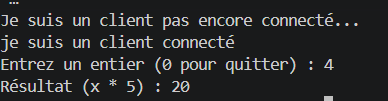
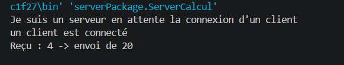
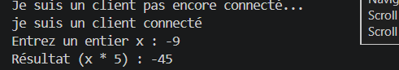
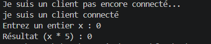
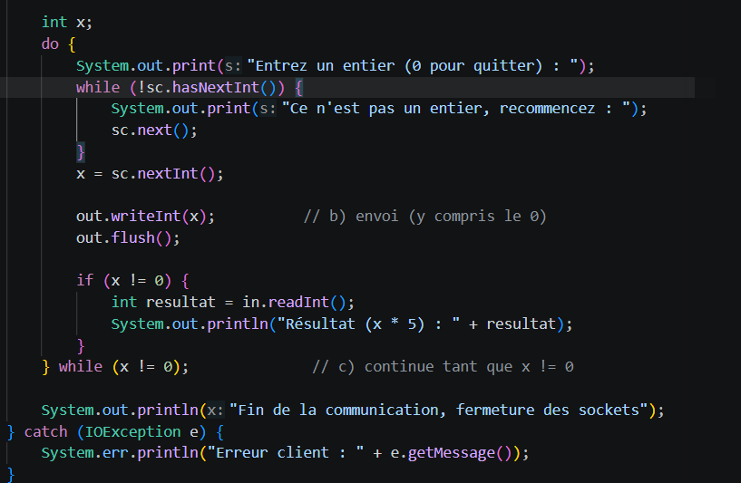
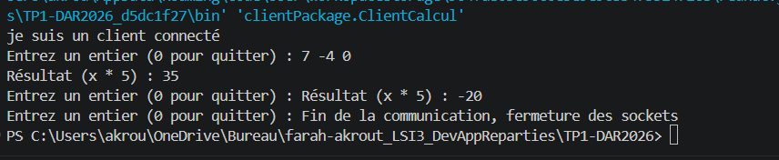
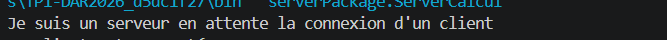
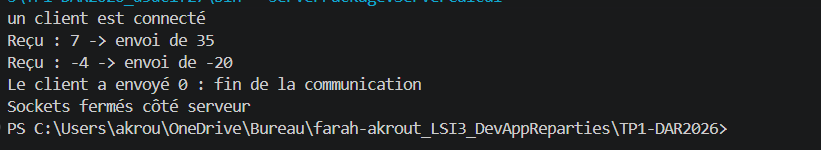

# TP1 - Activité 1-2 : service de calcul avec des sockets TCP

**Étudiante :** Farah Akrout, LSI3  
**Module :** Développement d'applications réparties  
**Dépôt :** TP1-DAR2026

La première activité, consacrée à l'établissement d'une connexion entre un client et un serveur, est présentée dans [README-activite-1-1.md](README-activite-1-1.md).

---

## Objectif

Cette activité consiste à étendre la communication client-serveur pour effectuer un calcul. Le client transmet un entier `x`, le serveur le multiplie par 5, puis renvoie le résultat au client.

## Organisation du projet

Les classes de l'activité 1-1 sont conservées. Les classes `ServerCalcul` et `ClientCalcul` sont dédiées à cette activité et se trouvent dans les mêmes packages :

## Échange des données

Le client et le serveur utilisent `DataOutputStream` et `DataInputStream` pour échanger des valeurs de type `int`. Les méthodes `writeInt()` et `readInt()` transmettent l'entier sur quatre octets, ce qui permet de préserver sa valeur, y compris lorsqu'il est négatif.

La communication se déroule ainsi :

1. Le client lit un entier saisi au clavier.
2. Il l'envoie au serveur avec `writeInt()`.
3. Le serveur le reçoit avec `readInt()`, le multiplie par 5 et renvoie le résultat.
4. Le client reçoit ce résultat avec `readInt()` et l'affiche.

Le client peut envoyer plusieurs entiers au cours de la même connexion. La valeur `0` sert de signal d'arrêt : le client l'envoie, puis le serveur met fin à la boucle sans renvoyer de résultat pour cette valeur. Les deux programmes ferment alors leurs sockets.

### Tests avec un seul entier

J'ai lancé d'abord le serveur, puis le client.

**Valeur positive (x = 4)**

Le client reçoit 20.

Le serveur a bien reçu 4 et renvoyé 4 × 5.

**Valeur négative (x = -9)**

Le client reçoit -45. Le signe est conservé, ce qui confirme l'intérêt de `DataInputStream` et `DataOutputStream`.

**Valeur nulle (x = 0)**

Le client reçoit 0, car 0 × 5 = 0.

---

## Étape 3 - Saisie de plusieurs entiers

### Fonctionnement

- Le client demande un entier en boucle.
- Après chaque saisie, il envoie l'entier, reçoit le résultat et l'affiche.
- La boucle s'arrête quand l'utilisateur saisit **0**.
- Le client envoie ce 0 au serveur, qui sort alors de sa boucle. Les deux côtés ferment leurs sockets.

J'ai saisi successivement 7, -4, puis 0.

**Console du client**

**Console du serveur**

### Interprétation

Pour chaque entier non nul, le client reçoit son produit par 5 (35, -20). Quand j'ai saisi 0, le client l'a envoyé puis s'est arrêté sans attendre de réponse. Le serveur a reçu ce 0, est sorti de sa boucle et a fermé ses sockets. Les deux programmes se sont donc terminés proprement.

>

## Conclusion

Cette activité met en pratique l'échange de données entières sur une connexion TCP. Le serveur effectue une multiplication par 5 pour chaque valeur reçue, tandis que le client affiche les réponses. La saisie de `0` permet de terminer l'échange et de fermer proprement les sockets.
