# TP1 - Activité 1-3 : Deux machines et calculatrice améliorée

**Étudiante :** Farah Akrout, LSI3
**tp :** Développement d'applications réparties
**Dépôt :** TP1-DAR2026

Activités précédentes : [activité 1-1](README-activite-1-1.md) et [activité 1-2](README-activite-1-2.md).

---

## Objectifs

1. Faire communiquer un client et un serveur situés sur **deux machines distinctes** du même réseau local.
2. Enrichir la calculatrice avec **quatre opérations** (addition, soustraction, multiplication, division) choisies par le client dans un menu.

## Organisation

```text
src/
├── serverPackage/ServerCalcul2.java
└── clientPackage/ClientCalcul2.java
```

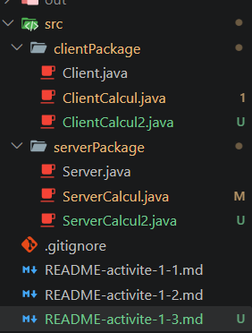

---

## Étape 1 - Connexion sur deux machines

### Classes utilisées

- **`InetAddress`** représente une adresse IP (`InetAddress.getByName(...)`).
- **`InetSocketAddress`** associe une adresse IP et un numéro de port.
  - Côté serveur : `ss.bind(new InetSocketAddress(ip, port))`.
  - Côté client : `s.connect(new InetSocketAddress(ip, port), 5000)`, avec un délai maximal de 5 secondes.

### Pourquoi `localhost` ne suffit plus

`localhost` désigne toujours **la machine courante**. Sur deux machines, un client qui viserait `localhost` chercherait le serveur sur sa propre machine. Il faut donc utiliser l'adresse IP réelle du serveur. J'ai aussi constaté qu'un serveur qui écoute sur son IP réelle refuse les connexions vers `127.0.0.1` : c'est une adresse différente.

### Adresse IP du serveur

Avec la commande `ipconfig` sur la machine serveur, j'ai relevé l'adresse IPv4 de la carte Wi-Fi : **192.168.1.80**.

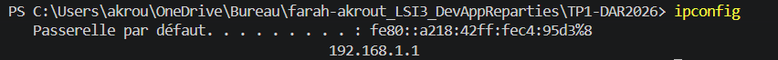

### Lancement

Serveur, sur la machine serveur :

```powershell
java -cp out serverPackage.ServerCalcul2 192.168.1.80 5000
```

Client, sur la machine client, avec l'adresse IP du serveur :

```powershell
java -cp out clientPackage.ClientCalcul2 192.168.1.80 5000
```

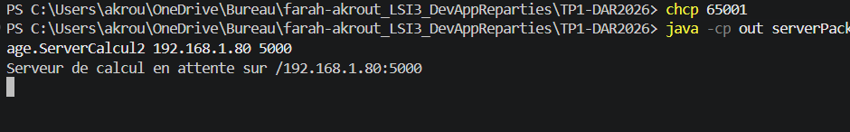

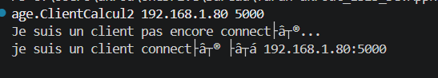

Le serveur affiche l'adresse IP du client connecté (`un client est connecté : ...`). Quand le client est sur une autre machine, cette adresse est différente de celle du serveur.

### Pare-feu

Le pare-feu Windows peut bloquer les connexions entrantes. J'ai autorisé Java, ou le port 5000, avec :

```powershell
New-NetFirewallRule -DisplayName "TP DAR 5000" -Direction Inbound -Protocol TCP -LocalPort 5000 -Action Allow
```

---

## Étape 2 - Calculatrice améliorée

### Protocole d'échange

Pour chaque calcul, le client envoie :

1. le **choix** de l'opération (`writeInt`) : 1 addition, 2 soustraction, 3 multiplication, 4 division, 0 quitter ;
2. les deux nombres **x** et **y** (`writeDouble`).

Le serveur répond avec :

1. un **booléen** : `true` si le calcul a réussi, `false` en cas d'erreur ;
2. puis le **résultat** (`writeDouble`), ou un **message d'erreur** (`writeUTF`).

Ce booléen permet au client de savoir quel type de donnée lire ensuite.

### Code du serveur

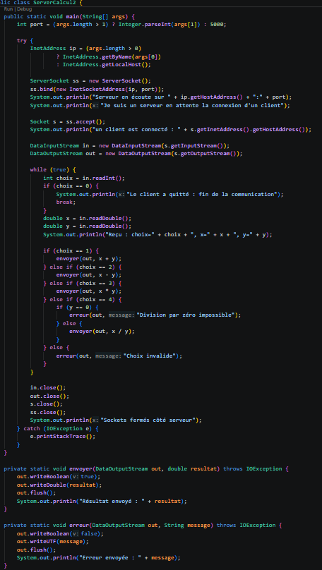

Le serveur lit le choix, puis x et y, effectue le calcul avec une structure conditionnelle, et renvoie le résultat. La division par zéro est détectée côté serveur et renvoie un message d'erreur.

### Code du client

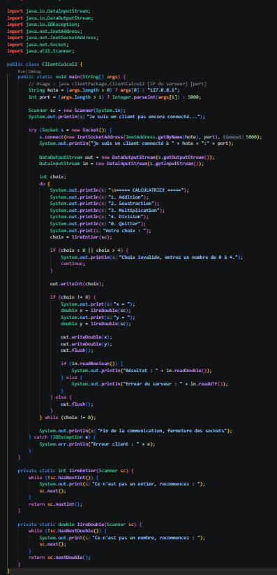

Le client affiche le menu, contrôle la saisie (un entier pour le choix, un nombre pour x et y), envoie les données et affiche la réponse. Le choix 0 envoie un signal d'arrêt au serveur, puis le client ferme son socket.

### Tests

| Opération      | x   | y   | Résultat obtenu |
| -------------- | --- | --- | --------------- |
| Addition       | 12  | 8   | 20.0            |
| Soustraction   | 12  | 8   | 4.0             |
| Multiplication | 12  | 8   | 96.0            |

| Division par zéro | 5 | 0 | Erreur : Division par zéro impossible |

**Addition et soustraction**

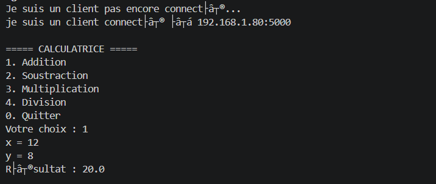

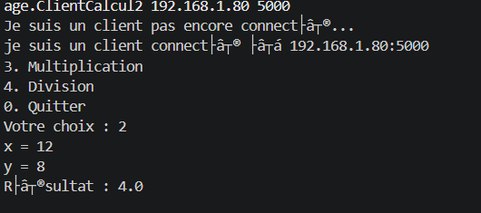

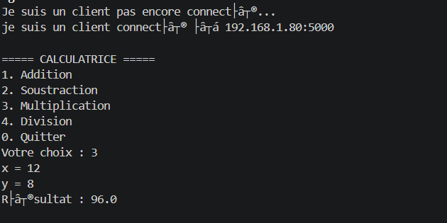

**Division par zéro**

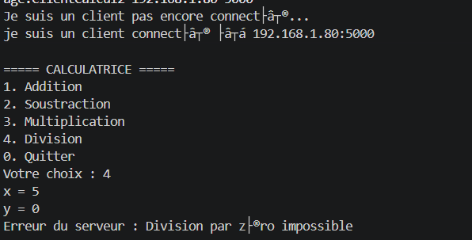

**Arrêt propre (choix 0)**

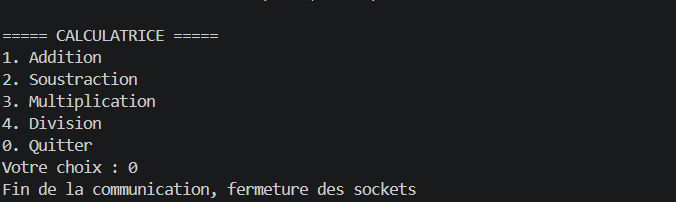

### Interprétation

Chaque opération renvoie le résultat attendu. Le calcul est fait côté serveur, et le client ne fait que saisir, envoyer et afficher. Pour la division par zéro, le serveur ne plante pas : il renvoie un message d'erreur que le client affiche. Avec le choix 0, le client prévient le serveur, qui sort de sa boucle. Les deux côtés ferment alors leurs sockets.

---

---

## Conclusion

Cette activité m'a permis de faire communiquer deux applications à travers un réseau local, avec `InetAddress` et `InetSocketAddress`, et d'enrichir le service avec un menu de quatre opérations. J'ai appris qu'il faut utiliser l'adresse IP réelle du serveur à la place de `localhost`, et que le pare-feu peut bloquer les connexions entrantes.
