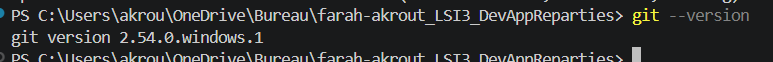
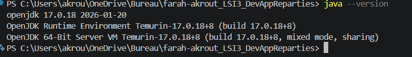
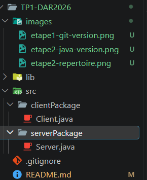
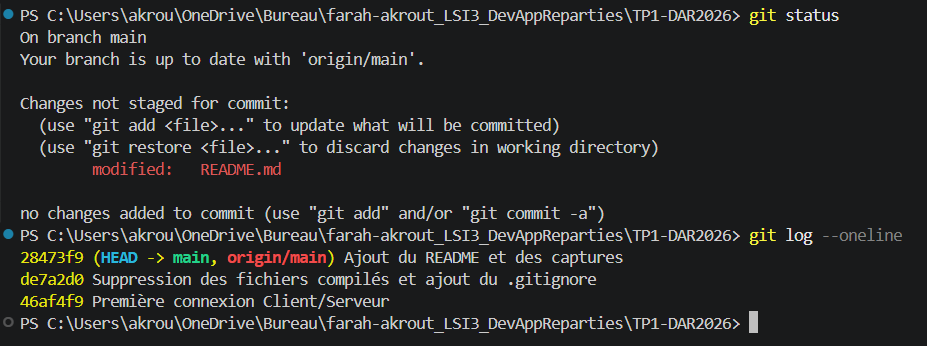
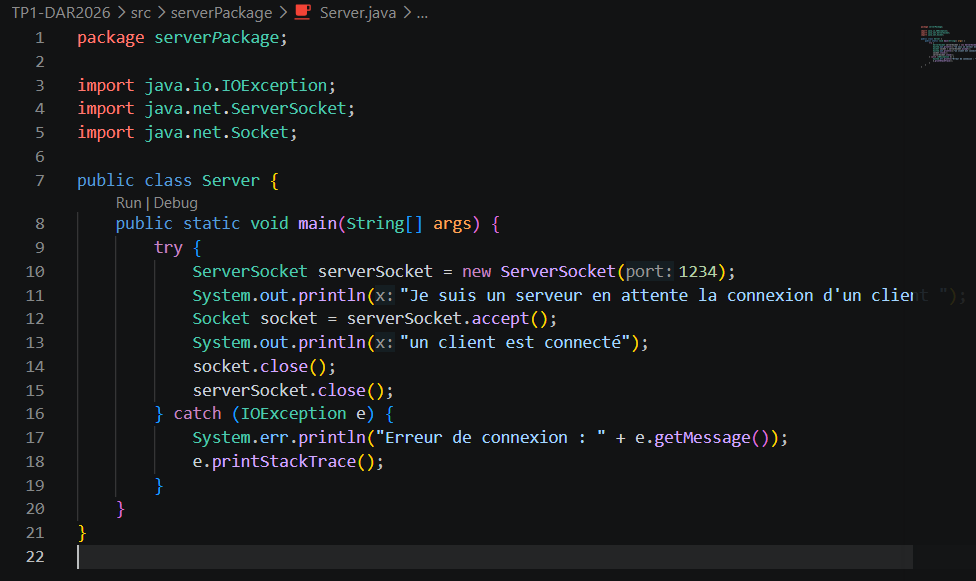
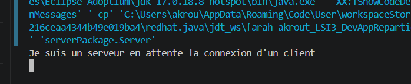
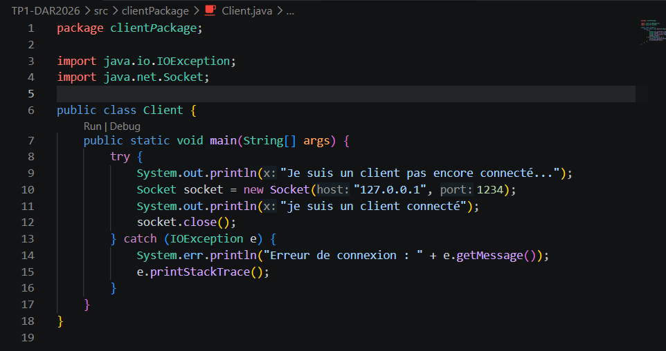
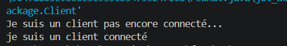
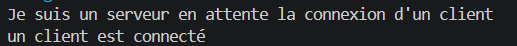

# TP1 - Communication Client/Serveur avec les sockets TCP en Java

**Étudiante :** Farah Akrout, LSI3
**tp :** Développement d'applications réparties
**Dépôt :** TP1-DAR2026

## Objectif

Établir une communication entre un client et un serveur en Java à l'aide des sockets en mode connecté (TCP).

---

## Étape 1 - Préparation de l'environnement Git

Je vérifie que Git est installé avec la commande `git --version`.



Git est bien installé sur mon poste : la commande affiche la version installée.

---

## Étape 2 - Préparation de l'environnement Java

### Vérification de Java

Je vérifie la version de Java avec la commande `java --version`.



Java 17 (Temurin) est installé et la commande est reconnue, donc la variable d'environnement PATH est correctement configurée.

### Création du répertoire de travail

J'ai créé le répertoire `farah-akrout_LSI3_DevAppReparties`, qui contient le projet.


---

## Étape 3 - Création du serveur

### Création du projet

J'ai créé le projet Java `TP1-DAR2026` dans VS Code, puis initialisé un dépôt Git à l'intérieur.





### Code du serveur

La classe `Server` se trouve dans le package `serverPackage` (`src/serverPackage/Server.java`).

```java
package serverPackage;

import java.io.IOException;
import java.net.ServerSocket;
import java.net.Socket;

public class Server {
    public static void main(String[] args) {
        try {
            // Création du ServerSocket sur le port 1234
            ServerSocket serverSocket = new ServerSocket(1234);
            System.out.println("Je suis un serveur en attente la connexion d'un client");

            // Attente bloquante d'une connexion
            Socket socket = serverSocket.accept();
            System.out.println("un client est connecté");

            // Fermeture des sockets
            socket.close();
            serverSocket.close();
        } catch (IOException e) {
            e.printStackTrace();
        }
    }
}
```



### Exécution du serveur

```text
Je suis un serveur en attente la connexion d'un client
```



### Interprétation

Le serveur crée un `ServerSocket` sur le port 1234 et affiche son message d'attente. La méthode `accept()` est bloquante : le programme reste arrêté à cette ligne tant qu'aucun client ne se connecte. C'est pourquoi la console ne affiche rien d'autre au départ. Dès qu'un client se connecte, le serveur affiche « un client est connecté », puis ferme les sockets.

---

## Étape 4 - Création du client

### Code du client

La classe `Client` se trouve dans le package `clientPackage` (`src/clientPackage/Client.java`).

```java
package clientPackage;

import java.io.IOException;
import java.net.Socket;

public class Client {
    public static void main(String[] args) {
        try {
            System.out.println("Je suis un client pas encore connecté...");
            Socket socket = new Socket("localhost", 1234);
            System.out.println("je suis un client connecté");
            socket.close();
        } catch (IOException e) {
            System.err.println("Erreur de connexion : " + e.getMessage());
            e.printStackTrace();
        }
    }
}
```



### Exécution avec localhost

J'ai lancé le serveur, puis le client.

Console du client :

```text
Je suis un client pas encore connecté...
je suis un client connecté
```



Console du serveur après la connexion :

```text
Je suis un serveur en attente la connexion d'un client
un client est connecté
```



### Interprétation

Le client affiche d'abord qu'il n'est pas encore connecté, puis crée un `Socket` vers le serveur (même machine, port 1234). Quand la connexion est acceptée, il affiche « je suis un client connecté » et ferme sa socket. Du côté du serveur, l'appel à `accept()` se débloque et le message « un client est connecté » s'affiche. La connexion TCP a donc bien été établie entre les deux applications.

### Remplacement de localhost par une adresse IP

J'ai remplacé le nom `localhost` par l'adresse IP de la machine (`127.0.0.1`) :

```java
Socket socket = new Socket("127.0.0.1", 1234);
```

Le résultat est identique : `localhost` est simplement le nom associé à l'adresse `127.0.0.1`, qui désigne la machine locale.

---

## Conclusion

Ce TP m'a permis de mettre en place une communication TCP entre un serveur et un client en Java. Le serveur attend une connexion avec `ServerSocket.accept()`, le client s'y connecte avec `Socket`, puis les deux ferment leurs sockets. Le dépôt Git contient le code source et ce README avec les captures de chaque étape.
